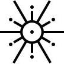
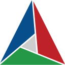
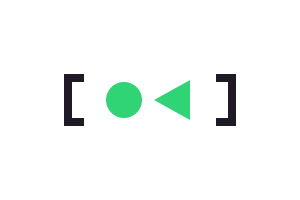
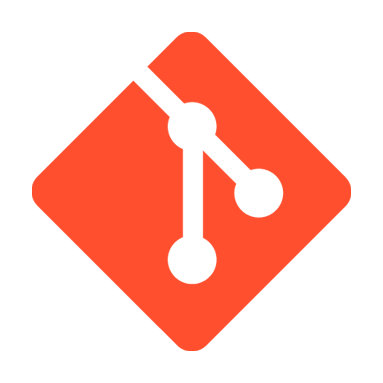
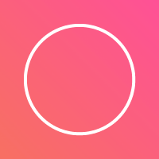
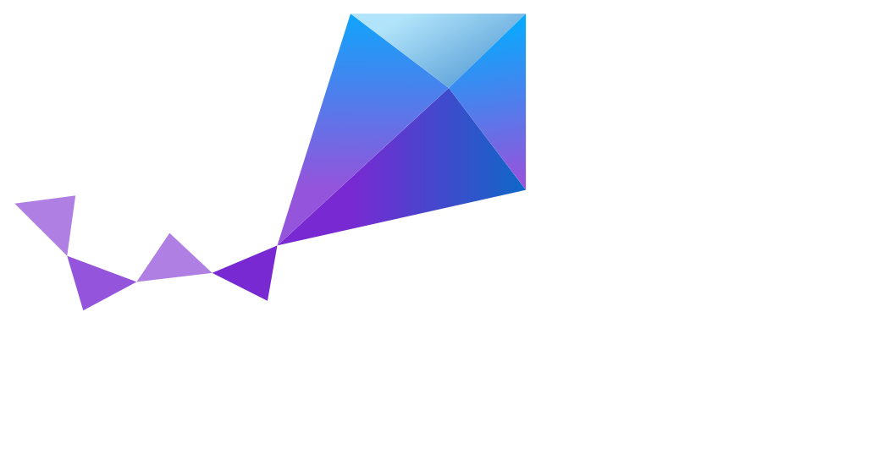

## Hello, world!

<a href="https://github.com/anuraghazra/github-readme-stats">
  <!--
  Width refers to the document's width. Using a 40% allows GitHub's iOS app to
  look decent
  -->
  
</a>

I'm Altair, an embedded Linux engineer from Málaga

- Building firmware for connected devices
- Rust and C, focused on fast and reliable software
- Making devices secure by design, from secure boot to signed updates
- Enjoys hard embedded problems

 

## Languages and Tools

  <!--Rust-->
  
  <!--Tokio-->
  
  <!--C-->
  
  <!--CMake-->
  
  <!--Python-->
  
  <!--TypeScript-->
  
  <!--Linux-->
  
  <!--Yocto Project-->
  
  <!--systemd-->
  
  <!--D-Bus-->
  
  <!--BlueZ-->
  
  <!--OSTree-->
  
  <!--U-Boot-->
  
  <!--NXP-->
  
  <!--FreeRTOS-->
  
  <!--MQTT-->
  
  <!--Docker-->
  
  <!--Kubernetes-->
  
  <!--Apache Kafka-->
  
  <!--Git-->
  
  <!--GitHub-->
  
  <!--GitLab-->
  
  <!--Conventional commits-->
  
  <!--UNIX OS-->
  

## Learn next

  <!--Zephyr-->
  
  <!--Embassy-->
  

